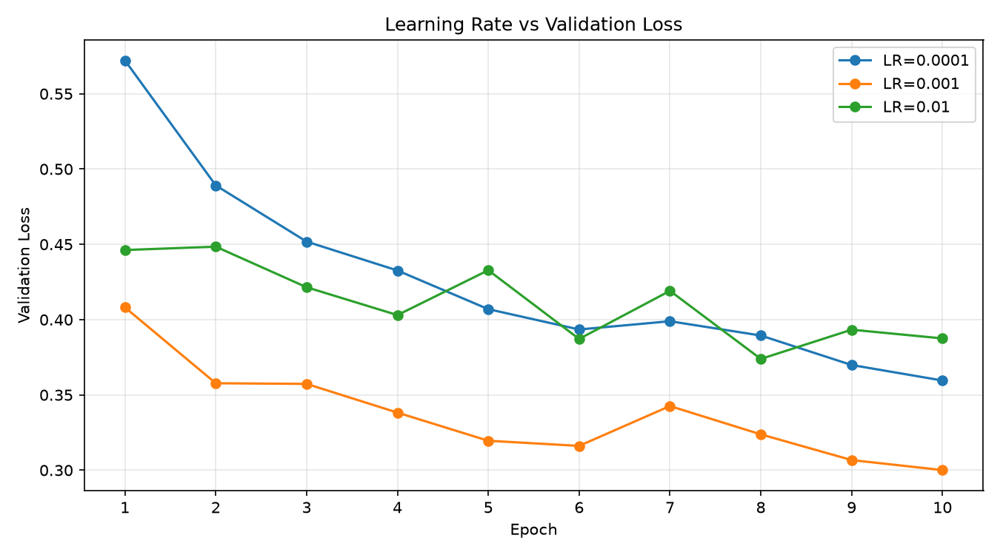
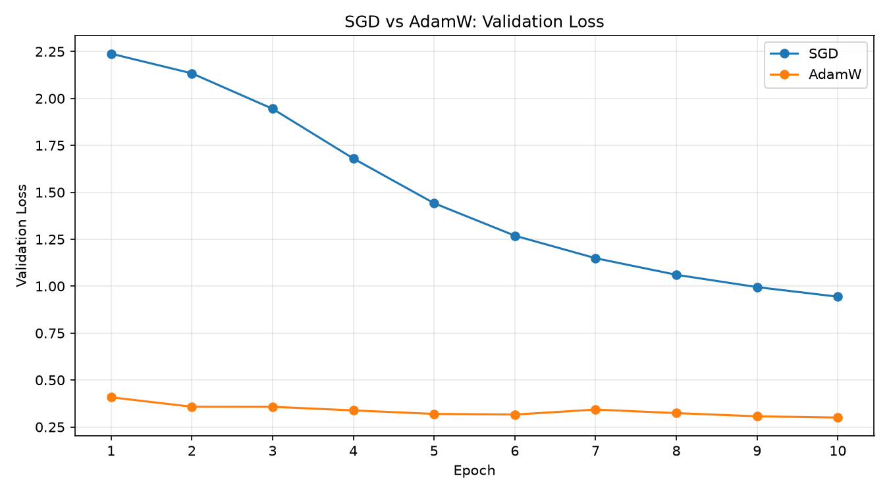

# PyTorch Deep Learning Fundamentals

A PyTorch implementation of a multilayer perceptron (MLP) for Fashion-MNIST classification, with reproducible training, model checkpointing, and experiments comparing network size, learning rate, and optimization methods.

## Overview

The project implements a complete image classification pipeline using PyTorch, including data preprocessing, mini-batch training, validation, checkpoint management, and evaluation on a held-out test set.

The main model is a fully connected neural network with two hidden layers. Additional experiments examine how architectural and training choices affect convergence and generalization.

## Model Architecture

Fashion-MNIST contains 28 × 28 grayscale images across 10 clothing categories.

The MLP uses the following architecture:

```text
Input (1 × 28 × 28)
       |
     Flatten
       |
 Linear(784, 256)
       |
      ReLU
       |
 Linear(256, 128)
       |
      ReLU
       |
 Linear(128, 10)
       |
     Logits
```

The model has **235,146 trainable parameters**. The output layer returns raw logits, which are passed directly to `CrossEntropyLoss`.

### Training Configuration

| Parameter          | Value         |
| ------------------ | ------------- |
| Dataset            | Fashion-MNIST |
| Optimizer          | AdamW         |
| Learning rate      | 0.001         |
| Weight decay       | 0.01          |
| Batch size         | 64            |
| Epochs             | 10            |
| Random seed        | 42            |
| Training samples   | 50,000        |
| Validation samples | 10,000        |
| Test samples       | 10,000        |

The original Fashion-MNIST training set is split into training and validation subsets using a fixed random seed. The official test set is kept separate.

## Setup

The project was developed with Python 3.13 and PyTorch on macOS using Apple MPS acceleration.

Clone the repository:

```bash
git clone https://github.com/SancitaL/pytorch-deep-learning-fundamentals.git
cd pytorch-deep-learning-fundamentals
```

Create a virtual environment and install the dependencies:

```bash
python3 -m venv .venv
source .venv/bin/activate
python -m pip install -r requirements.txt
```

The Fashion-MNIST dataset is downloaded automatically through `torchvision`.

## Usage

### Training

```bash
python train.py
```

The training script runs the baseline MLP for 10 epochs and evaluates it against the validation set after each epoch.

When validation loss improves, the checkpoint is updated at:

```text
checkpoints/best_model.pt
```

Training metrics and curves are written to:

```text
results/training_history.csv
results/training_curves.png
```

### Evaluation

```bash
python evaluate.py
```

This loads the saved checkpoint and evaluates the model on the official Fashion-MNIST test set without updating model parameters.

Results are saved to `results/test_results.csv`.

## Results

### Baseline Performance

| Metric                |      Value |
| --------------------- | ---------: |
| Training accuracy     |     91.12% |
| Validation accuracy   |     88.84% |
| Validation loss       |     0.3001 |
| Test accuracy         | **88.23%** |
| Test loss             |     0.3293 |
| Best checkpoint epoch |         10 |

The difference between validation and test accuracy is 0.61 percentage points.

### Hidden Size Comparison

Three architectures were trained using the same optimizer, data split, and training configuration.

| Model    | Hidden layers | Parameters | Validation accuracy |
| -------- | ------------- | ---------: | ------------------: |
| Small    | 128, 64       |    109,386 |              88.26% |
| Baseline | 256, 128      |    235,146 |              88.84% |
| Large    | 512, 256      |    535,818 |              89.53% |

The larger model achieved the highest validation accuracy, although its parameter count was nearly five times that of the smallest model.

Run:

```bash
python -m experiments.hidden_size_experiment
```

### Learning Rate Comparison

The baseline architecture was trained with AdamW using three learning rates.

| Learning rate | Validation loss | Validation accuracy |
| ------------- | --------------: | ------------------: |
| 0.0001        |          0.3596 |              87.23% |
| 0.001         |          0.3001 |              88.84% |
| 0.01          |          0.3875 |              86.20% |

The `0.001` configuration produced the lowest final validation loss. The smaller learning rate converged more slowly, while `0.01` showed greater fluctuations in validation loss.

Run:

```bash
python -m experiments.learning_rate_experiment
```



### Optimizer Comparison

SGD and AdamW were evaluated using the same architecture, learning rate, batch size, and training budget.

| Optimizer | Training loss | Validation loss | Validation accuracy |
| --------- | ------------: | --------------: | ------------------: |
| SGD       |        0.9621 |          0.9440 |              66.10% |
| AdamW     |        0.2374 |          0.3001 |              88.84% |

AdamW converged substantially faster under the tested settings. SGD was used without momentum, and the learning rate was not tuned separately for each optimizer.

Run:

```bash
python -m experiments.optimizer_comparison
```



## Checkpointing

The training pipeline saves the model with the lowest validation loss.

The checkpoint contains model weights, optimizer state, training configuration, and validation metrics.

Saved weights are loaded into a new model instance using `load_state_dict()`. The loading process was checked by evaluating the restored model and comparing its validation loss with the recorded checkpoint value.

## Repository Structure

```text
.
├── train.py
├── evaluate.py
├── requirements.txt
├── models/
│   ├── simple_mlp.py
│   └── fashion_mnist_mlp.py
├── training/
│   ├── train_loop.py
│   ├── fashion_mnist_train.py
│   └── checkpoint_demo.py
├── experiments/
│   ├── hidden_size_experiment.py
│   ├── learning_rate_experiment.py
│   └── optimizer_comparison.py
├── results/
├── checkpoints/
│   └── best_model.pt
└── fundamentals/
```

The `fundamentals/` directory contains implementations and examples covering tensor operations, activation functions, automatic differentiation, and backpropagation.

## Notes

- All experiments use a fixed training/validation split and random seed.
- Training runs on Apple MPS when available, with CPU fallback.
- Numerical results may vary slightly across devices and PyTorch versions.
- The comparisons use a limited set of configurations and a single random seed.
- The test set is not used for training or hyperparameter selection.